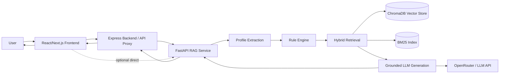
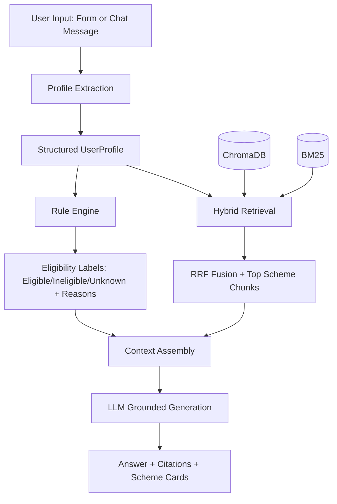
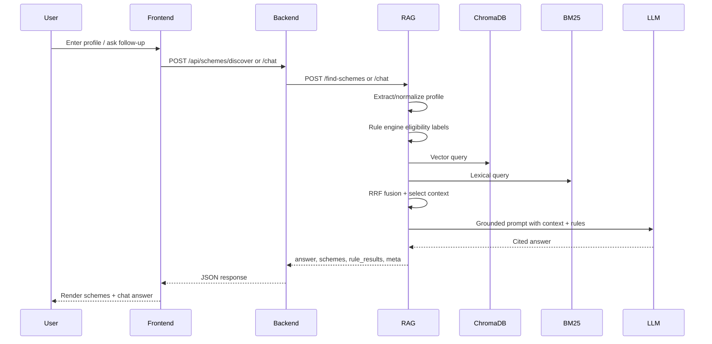

# Vectro - College Project Report Pack (Claude-Ready)

> **Purpose**: Give this file + your college report format/template to Claude to generate a ~50-page project report.  
> **Status note**: Code below is presented as the **target final implementation** (as if Part 1 profile extraction, Part 2 rule engine, and Part 3 ChromaDB+BM25 hybrid RAG are fully implemented and integrated).

---

## 1. How to Use This With Claude

Copy/paste this prompt to Claude along with your college format:

```text
You are writing a college project report for my project "Vectro - AI-Powered Government Scheme Discovery using RAG". 
Use the attached REPORT_PACK.md as the source of truth for project description, architecture, pipeline, modules, algorithms, and final-form code. 
Use the attached college format/template strictly (section order, headings, font, margins, spacing, citation style, front matter, page numbering, headers/footers, figure/table captions).

Requirements:
- Produce a complete ~50 page report.
- Keep technical claims grounded in the provided code and architecture.
- Present the code as final implemented code in Appendix/Implementation sections as required by format.
- Include diagrams (architecture, DFD/data flow, sequence, ER/data schema, UI mockups/screenshots placeholders).
- Include test cases, results tables, limitations, future scope, and references.
- Where real screenshots/metrics are missing, insert clearly marked placeholders like [INSERT SCREENSHOT: ...] and [INSERT METRIC: ...].
- Do not invent fake experimental results; use plausible sample outputs only where labeled "Sample Output".
- Write in formal academic tone.
```

---

## 2. Project Snapshot

- **Project Title**: Vectro - AI-Powered Government Scheme Discovery Platform
- **Domain**: AI/ML, Information Retrieval, Web Application, E-Governance
- **Problem**: Citizens struggle to find relevant government schemes due to scattered information, complex eligibility rules, and difficult language.
- **Solution**: A RAG-based chatbot/web app that collects user profile, applies eligibility rules, retrieves relevant scheme chunks using hybrid search (ChromaDB vector + BM25), and generates grounded answers with citations.
- **Core Pipeline**: `User Input (Form/Chat) -> Profile Extraction -> Rule Engine (Eligible/Ineligible/Unknown) -> Hybrid Retrieval (ChromaDB + BM25 + RRF) -> Grounded LLM Answer with Citations`

---

## 3. Suggested 50-Page Report Structure

Adjust to your college format. Suggested page budget:

---

## 4. Abstract (Draft)

Vectro is an AI-powered government scheme discovery system designed to help citizens identify relevant welfare schemes based on their personal and socio-economic profile. Traditional scheme discovery portals require users to manually browse large catalogs and interpret complex eligibility criteria. Vectro addresses this by combining structured profile collection, rule-based eligibility assessment, and Retrieval-Augmented Generation (RAG). The system extracts or accepts a user profile, evaluates scheme eligibility as eligible, ineligible, or unknown using deterministic rules, and retrieves relevant scheme information through hybrid search combining ChromaDB semantic vector retrieval and BM25 lexical ranking using Reciprocal Rank Fusion (RRF). A large language model generates grounded responses with source citations, reducing hallucination and improving trust. The prototype demonstrates a practical approach for accessible, explainable, and citizen-centric e-governance assistance.

---

## 5. Introduction (Key Points)

### 5.1 Background
- Government schemes cover health, education, agriculture, housing, employment, finance, women/child welfare, etc.
- Information is distributed across portals, PDFs, notices; eligibility rules are complex.

### 5.2 Problem Statement
Design and implement an intelligent system that can understand a user's profile or query, identify relevant government schemes, assess eligibility, and provide grounded, citation-backed answers.

### 5.3 Objectives
- Collect user profile through form or chat.
- Extract structured profile from natural language.
- Apply rule engine to classify schemes as eligible/ineligible/unknown.
- Retrieve relevant scheme chunks using hybrid search (ChromaDB + BM25 + RRF).
- Generate grounded, cited responses.
- Provide web UI for discovery and follow-up chat.

### 5.4 Scope
- Prototype for Indian government scheme discovery.
- English/Hindi UI labels (existing frontend has bilingual strings in places).
- Uses curated scheme dataset (`rag_data.jsonl`) and prebuilt/persisted index.

### 5.5 Limitations
- Depends on dataset quality/freshness.
- LLM extraction/generation may err; mitigated by rules, grounding, citations.
- Eligibility rules are heuristic/metadata-based where official rules are ambiguous.
- Not legal/advisory authority; users should verify on official portals.

---

## 6. Literature Survey / Related Work (Topics to Expand)

1. **Keyword Search vs Semantic Search** - TF-IDF/BM25 limitations; embeddings capture semantic similarity.
2. **BM25** - Probabilistic lexical retrieval; strong for exact terms, names, IDs.
3. **Dense Retrieval / Sentence Transformers** - `all-MiniLM-L6-v2` style embeddings; cosine similarity.
4. **Hybrid Retrieval & RRF** - Combining lexical and dense rankings; Reciprocal Rank Fusion.
5. **Vector Databases (ChromaDB/FAISS)** - Persistent storage, ANN/vector search, metadata.
6. **RAG** - Retrieval before generation reduces hallucination; citations improve trust.
7. **Rule-based Eligibility Systems** - Deterministic checks for explainability.
8. **E-Governance Chatbots** - Existing portals (MyScheme etc.), gaps: personalization, explainability, conversational follow-up.

Suggested reference placeholders:
- Robertson et al., BM25 / Probabilistic Relevance Framework.
- Lewis et al., Retrieval-Augmented Generation for Knowledge-Intensive NLP (2020).
- Reimers & Gurevych, Sentence-BERT (2019).
- Cormack et al., Reciprocal Rank Fusion (2009).
- ChromaDB documentation.
- FastAPI / React / Next.js documentation (as applicable).
- MyScheme / India government scheme portal references.

---

## 7. Existing System vs Proposed System

### Existing System
- Manual portal browsing and keyword search.
- Users must interpret eligibility criteria themselves.
- No personalized conversational follow-up.
- Difficult to compare schemes across documents.

### Proposed System
- Profile-driven discovery.
- Chat/form input.
- Rule engine gives explicit eligibility status with reasons.
- Hybrid retrieval finds relevant schemes.
- LLM generates grounded answer with citations.
- Follow-up chat uses same profile and RAG pipeline.

---

## 8. Requirements

### 8.1 Functional Requirements
- FR1: User can enter profile via 7-question form.
- FR2: User can ask natural-language chat query.
- FR3: System extracts structured profile from chat.
- FR4: System evaluates eligibility as Eligible/Ineligible/Unknown with reasons.
- FR5: System retrieves relevant schemes using ChromaDB + BM25.
- FR6: System generates grounded answer with citations.
- FR7: User can ask follow-up questions after scheme recommendation.
- FR8: API exposes `/health`, `/find-schemes`, `/chat`.

### 8.2 Non-Functional Requirements
- NFR1: Grounded responses; no fabricated scheme facts.
- NFR2: Explainability via rule reasons and citations.
- NFR3: Reasonable response latency for demo.
- NFR4: Modular architecture.
- NFR5: Persistent vector index.

### 8.3 Hardware/Software Requirements
- **Hardware**: 8GB+ RAM recommended, CPU sufficient for demo; disk for Chroma index.
- **Software**: Python 3.10+, Node.js 18+, uv/pip, browser; optional OpenRouter API key.

---

## 9. System Architecture

### 9.1 High-Level Architecture (Mermaid)



### 9.2 Final Pipeline (Mermaid)



### 9.3 Sequence Diagram (Mermaid)



---

## 10. Data Design

### 10.1 Dataset
- Source file: `RAG/chatbot/rag_data.jsonl`
- Contains scheme records: name, state, level, ministry, categories, eligibility, benefits, documents, application process, source URL etc.

### 10.2 Chunk Schema (Conceptual)

```json
{
  "chunk_id": "scheme_id:section:chunk_no",
  "scheme_id": "...",
  "text": "...",
  "section": "summary|benefits|eligibility|documents_required|application_process|detailed_description",
  "chunk_no": 0,
  "metadata": {
    "scheme_name": "...",
    "state": "...",
    "level": "...",
    "categories_csv": "...",
    "eligibility_min_age": 18,
    "eligibility_max_age": 35,
    "eligibility_max_income": 300000,
    "eligibility_gender": "any",
    "eligibility_caste_tags_csv": "sc,obc",
    "eligibility_residency_csv": "rural",
    "source_url": "..."
  }
}
```

### 10.3 ChromaDB + BM25 Artifacts
- `chroma_index/chroma_db/` - persistent Chroma collection.
- `chroma_index/chunks.jsonl` - canonical chunk store.
- `chroma_index/bm25_tokens.pkl` - BM25 token corpus.
- `chroma_index/manifest.json` - build metadata.

---

## 11. Module Description (Final)

### 11.1 Profile Extraction Module (`profile_extract.py`)
- **Input**: free-text chat message.
- **Output**: structured profile, missing fields, confidence/source.
- **Method**: LLM JSON extraction when API key available; regex/heuristic fallback otherwise.
- **Normalization**: age int, income rupees, gender/caste/residency/state canonical forms.

### 11.2 Rule Engine (`rule_engine.py`)
- **Input**: normalized profile + scheme metadata.
- **Output**: `eligible | ineligible | unknown` + reasons.
- **Rules**: age range, income ceiling, gender, caste tag, residency, state applicability.
- **Design**: deterministic and explainable; unknown when required profile/scheme data missing.

### 11.3 Hybrid Retrieval (`retrieve.py`)
- **Vector**: ChromaDB query/embeddings for semantic matches.
- **Lexical**: BM25 for keyword relevance.
- **Fusion**: Reciprocal Rank Fusion.
- **Post-filter/rerank**: profile filters and rule-engine labels.

### 11.4 Generation (`generate.py`)
- Strict grounding prompt: answer only from retrieved context.
- Include eligibility labels/reasons.
- Citation format `[Source N]`.

### 11.5 API Layer (`main.py`)
- `/find-schemes`: structured profile -> rules + retrieval + generation.
- `/chat`: message + optional profile -> extraction + rules + retrieval + generation.

### 11.6 Frontend
- Discover form: 7-question profile.
- Results: scheme cards + AI answer.
- Follow-up chat: asks questions against same profile and RAG pipeline.

---

## 12. Final-Form Code (Target Implementation)

> These are the final-form/reference implementations for the report. They are designed to be consistent with the current repo and the described pipeline.

### 12.1 `RAG/requirements.txt`

```txt
fastapi
uvicorn
pydantic
python-dotenv
numpy
rank-bm25
sentence-transformers
langchain
langchain-community
langchain-huggingface
chromadb
openai
```

### 12.2 `RAG/chatbot/profile_extract.py`

```python
from __future__ import annotations

import json
import os
import re
from typing import Any, Dict, List, Optional

from dotenv import load_dotenv
from openai import OpenAI

load_dotenv()

STATE_ALIASES = {
    "andhra pradesh": "Andhra Pradesh", "arunachal pradesh": "Arunachal Pradesh",
    "assam": "Assam", "bihar": "Bihar", "chhattisgarh": "Chhattisgarh", "goa": "Goa",
    "gujarat": "Gujarat", "haryana": "Haryana", "himachal pradesh": "Himachal Pradesh",
    "jharkhand": "Jharkhand", "karnataka": "Karnataka", "kerala": "Kerala",
    "madhya pradesh": "Madhya Pradesh", "maharashtra": "Maharashtra", "manipur": "Manipur",
    "meghalaya": "Meghalaya", "mizoram": "Mizoram", "nagaland": "Nagaland", "odisha": "Odisha",
    "punjab": "Punjab", "rajasthan": "Rajasthan", "sikkim": "Sikkim", "tamil nadu": "Tamil Nadu",
    "telangana": "Telangana", "tripura": "Tripura", "uttar pradesh": "Uttar Pradesh",
    "uttarakhand": "Uttarakhand", "west bengal": "West Bengal", "delhi": "Delhi",
    "jammu and kashmir": "Jammu and Kashmir", "ladakh": "Ladakh", "puducherry": "Puducherry",
}

CASTE_MAP = {
    "sc": "sc", "scheduled caste": "sc",
    "st": "st", "scheduled tribe": "st",
    "obc": "obc", "other backward class": "obc", "other backward classes": "obc",
    "general": "general", "gen": "general", "ews": "ews", "bpl": "bpl",
}

PROFILE_FIELDS = ["age", "gender", "income", "state", "occupation", "caste", "residency"]


def _empty_profile() -> Dict[str, Any]:
    return {k: None for k in PROFILE_FIELDS}


def _norm_gender(v: Any) -> Optional[str]:
    t = str(v or "").strip().lower()
    if t in {"male", "m", "man", "boy"}: return "male"
    if t in {"female", "f", "woman", "girl"}: return "female"
    if t in {"other", "transgender"}: return "other"
    return None


def _norm_caste(v: Any) -> Optional[str]:
    t = str(v or "").strip().lower()
    return CASTE_MAP.get(t, t if t in CASTE_MAP.values() else None)


def _norm_residency(v: Any) -> Optional[str]:
    t = str(v or "").strip().lower()
    if "rural" in t or "village" in t: return "rural"
    if "urban" in t or "city" in t: return "urban"
    return None


def _norm_state(v: Any) -> Optional[str]:
    t = str(v or "").strip().lower()
    if not t: return None
    for k, name in STATE_ALIASES.items():
        if k in t: return name
    return str(v).strip().title()


def _parse_income(v: Any) -> Optional[int]:
    if v is None: return None
    if isinstance(v, (int, float)): return int(v)
    t = str(v).lower().replace(",", "").replace("₹", "").replace("rs.", "").strip()
    m = re.search(r"(\d+(?:\.\d+)?)\s*(lakh|lakhs|lac|l|crore|crores|cr)?", t)
    if not m: return None
    amt = float(m.group(1))
    unit = (m.group(2) or "").lower()
    if unit in {"lakh", "lakhs", "lac", "l"}: amt *= 100000
    elif unit in {"crore", "crores", "cr"}: amt *= 10000000
    return int(amt)


def _normalize_profile(raw: Dict[str, Any]) -> Dict[str, Any]:
    p = _empty_profile()
    age = raw.get("age")
    if age is not None:
        try:
            age_i = int(float(age))
            if 0 <= age_i <= 120: p["age"] = age_i
        except Exception: pass
    p["gender"] = _norm_gender(raw.get("gender"))
    p["income"] = _parse_income(raw.get("income"))
    p["state"] = _norm_state(raw.get("state"))
    p["occupation"] = (str(raw.get("occupation")).strip().lower() or None) if raw.get("occupation") else None
    p["caste"] = _norm_caste(raw.get("caste"))
    p["residency"] = _norm_residency(raw.get("residency"))
    return p


def _heuristic_extract(message: str) -> Dict[str, Any]:
    text = " " + message.lower() + " "
    p = _empty_profile()

    m = re.search(r"\b(\d{1,3})\s*(?:years?\s*old|yo|yrs?)\b", text)
    if m:
        age = int(m.group(1))
        if 0 <= age <= 120: p["age"] = age

    p["gender"] = _norm_gender(message)
    p["residency"] = _norm_residency(message)
    p["caste"] = _norm_caste(message)

    for k, name in STATE_ALIASES.items():
        if k in text:
            p["state"] = name
            break

    m = re.search(r"(?:income|earn|salary)[^\d]{0,20}(\d+(?:\.\d+)?)\s*(lakh|lakhs|lac|l|crore|cr)?", text)
    if m:
        p["income"] = _parse_income(m.group(0))

    for occ in ["student", "farmer", "agriculture", "unemployed", "business", "private", "government"]:
        if occ in text:
            p["occupation"] = "agriculture" if occ == "farmer" else occ
            break

    return p


def _llm_extract(message: str) -> Optional[Dict[str, Any]]:
    api_key = os.environ.get("OPENROUTER_API_KEY")
    if not api_key: return None
    client = OpenAI(base_url="https://openrouter.ai/api/v1", api_key=api_key)
    prompt = (
        "Extract user profile from the message. Return ONLY JSON with keys: "
        "age, gender, income, state, occupation, caste, residency. "
        "Use null for unknown. income must be annual INR integer when possible. "
        "Do not guess missing values.\n\nMessage:\n" + message
    )
    try:
        resp = client.chat.completions.create(
            model=os.environ.get("PROFILE_EXTRACT_MODEL", "google/gemini-2.5-flash"),
            temperature=0,
            messages=[{"role": "user", "content": prompt}],
        )
        content = resp.choices[0].message.content or "{}"
        m = re.search(r"\{.*\}", content, re.DOTALL)
        return json.loads(m.group(0) if m else content)
    except Exception:
        return None


def extract_profile_from_message(message: str) -> Dict[str, Any]:
    heuristic = _heuristic_extract(message)
    llm_raw = _llm_extract(message)
    llm = _normalize_profile(llm_raw or {})
    merged = _empty_profile()
    for k in PROFILE_FIELDS:
        merged[k] = llm.get(k) if llm.get(k) is not None else heuristic.get(k)
    missing = [k for k, v in merged.items() if v is None]
    return {
        "profile": merged,
        "missing_fields": missing,
        "source": "llm+heuristic" if llm_raw else "heuristic",
    }
```

### 12.3 `RAG/chatbot/rule_engine.py`

```python
from __future__ import annotations

from typing import Any, Dict, List


def _norm(v: Any) -> str:
    return str(v or "").strip().lower()


def evaluate_scheme_eligibility(profile: Dict[str, Any], scheme_meta: Dict[str, Any]) -> Dict[str, Any]:
    reasons: List[str] = []
    unknowns: List[str] = []
    eligible = True

    age = profile.get("age")
    min_age = scheme_meta.get("eligibility_min_age")
    max_age = scheme_meta.get("eligibility_max_age")
    if age is None and (min_age is not None or max_age is not None):
        unknowns.append("User age missing for age rule")
    else:
        if age is not None and min_age is not None and age < int(min_age):
            eligible = False; reasons.append(f"Age {age} < minimum {min_age}")
        if age is not None and max_age is not None and age > int(max_age):
            eligible = False; reasons.append(f"Age {age} > maximum {max_age}")
        if age is not None and (min_age is not None or max_age is not None):
            reasons.append("Age satisfies rule" if eligible else reasons[-1])

    income = profile.get("income")
    max_income = scheme_meta.get("eligibility_max_income")
    if max_income is not None:
        if income is None:
            unknowns.append("User income missing for income rule")
        elif int(income) > int(max_income):
            eligible = False; reasons.append(f"Income {income} > limit {max_income}")
        else:
            reasons.append(f"Income within limit {max_income}")

    user_gender = _norm(profile.get("gender"))
    req_gender = _norm(scheme_meta.get("eligibility_gender") or "any")
    if req_gender in {"male", "female"}:
        if not user_gender:
            unknowns.append("User gender missing for gender rule")
        elif user_gender != req_gender:
            eligible = False; reasons.append(f"Gender must be {req_gender}")
        else:
            reasons.append(f"Gender matches {req_gender}")

    user_caste = _norm(profile.get("caste"))
    caste_tags = [_norm(x) for x in (scheme_meta.get("eligibility_caste_tags") or []) if str(x).strip()]
    if caste_tags:
        if not user_caste:
            unknowns.append("User caste/category missing for caste rule")
        elif user_caste not in caste_tags:
            eligible = False; reasons.append(f"Caste {user_caste} not in {caste_tags}")
        else:
            reasons.append("Caste/category matches")

    user_res = _norm(profile.get("residency"))
    res_tags = [_norm(x) for x in (scheme_meta.get("eligibility_residency") or []) if str(x).strip()]
    if res_tags:
        if not user_res:
            unknowns.append("User residency missing for residency rule")
        elif user_res not in res_tags:
            eligible = False; reasons.append(f"Residency {user_res} not in {res_tags}")
        else:
            reasons.append("Residency matches")

    state = _norm(profile.get("state"))
    scheme_state = _norm(scheme_meta.get("state"))
    if scheme_state and scheme_state not in {"all", "all states", "india"}:
        if not state:
            unknowns.append("User state missing for state rule")
        elif state != scheme_state:
            eligible = False; reasons.append(f"Scheme state {scheme_state} != user state {state}")
        else:
            reasons.append("State matches")

    if not eligible:
        status = "ineligible"
    elif unknowns:
        status = "unknown"
    else:
        status = "eligible"

    return {"status": status, "reasons": reasons, "unknowns": unknowns}


def apply_rule_engine(profile: Dict[str, Any], schemes: List[Dict[str, Any]], chunks_by_scheme: Dict[str, Dict[str, Any]]) -> List[Dict[str, Any]]:
    out = []
    for s in schemes:
        meta = (chunks_by_scheme.get(s.get("scheme_id"), {}) or {}).get("metadata", {})
        # fallback: use scheme fields if metadata not found
        meta = meta or {
            "state": s.get("state"), "level": s.get("level"),
            "eligibility_min_age": s.get("eligibility_min_age"),
            "eligibility_max_age": s.get("eligibility_max_age"),
            "eligibility_max_income": s.get("eligibility_max_income"),
            "eligibility_gender": s.get("eligibility_gender", "any"),
            "eligibility_caste_tags": s.get("eligibility_caste_tags", []),
            "eligibility_residency": s.get("eligibility_residency", []),
        }
        rule = evaluate_scheme_eligibility(profile, meta)
        s2 = dict(s)
        s2["eligibility_status"] = rule["status"]
        s2["eligibility_reasons"] = rule["reasons"]
        s2["eligibility_unknowns"] = rule["unknowns"]
        out.append(s2)
    # rank: eligible > unknown > ineligible, preserve score within group
    order = {"eligible": 0, "unknown": 1, "ineligible": 2}
    out.sort(key=lambda x: (order.get(x.get("eligibility_status"), 1), -float(x.get("score", 0))))
    return out
```

### 12.4 `RAG/chatbot/retrieve.py` (Key Integration Changes)

```python
# Additions / changes to existing retrieve.py

from chatbot.rule_engine import apply_rule_engine

def retrieve_hybrid(..., profile_for_rules: Optional[Dict[str, Any]] = None) -> Dict[str, Any]:
    ...
    ranked_schemes = aggregate_by_scheme(artifacts.chunks, fused_scores, max_schemes=max_schemes)

    # Build scheme metadata lookup
    scheme_meta_lookup = {}
    for ch in artifacts.chunks:
        sid = ch.get("scheme_id")
        if sid and sid not in scheme_meta_lookup:
            scheme_meta_lookup[sid] = ch

    if profile_for_rules:
        ranked_schemes = apply_rule_engine(profile_for_rules, ranked_schemes, scheme_meta_lookup)

    context_chunks = _build_context_chunks(artifacts.chunks, fused_scores, max_chunks=8)
    ...
    return {
        "query": query,
        "total_schemes": len(ranked_schemes),
        "results": ranked_schemes,
        "context_chunks": context_chunks,
        "assistant_instructions": ASSISTANT_INSTRUCTIONS,
        "grounded_answer": "Top schemes returned from filtered context." if ranked_schemes else "I don't know based on the provided context.",
        "meta": meta,
    }
```

### 12.5 `RAG/chatbot/generate.py` (Grounding with Rule Labels)

```python
# In _build_user_prompt(...), include rule labels if present:
for i, scheme in enumerate(retrieval_result.get("results", []), start=1):
    status = scheme.get("eligibility_status", "unknown")
    reasons = "; ".join(scheme.get("eligibility_reasons", [])[:3])
    unknowns = "; ".join(scheme.get("eligibility_unknowns", [])[:2])
    lines.append(f"- {scheme.get('scheme_name')}: status={status}; reasons={reasons}; unknowns={unknowns}")

# Add instruction in system prompt:
# "Use eligibility_status from RULE ENGINE when present. Do not override rule engine decisions. If status is unknown, clearly state what user info is missing."
```

### 12.6 `RAG/main.py` (Final Target API)

```python
from fastapi import FastAPI
from pydantic import BaseModel
from typing import List, Optional
from fastapi.middleware.cors import CORSMiddleware
import os

from chatbot.retrieve import DEFAULT_MODEL_NAME, load_artifacts, retrieve_hybrid
from chatbot.generate import generate_schemes_response
from chatbot.profile_extract import extract_profile_from_message

artifacts = None

def get_artifacts():
    global artifacts
    if artifacts is None:
        index_path = "chatbot/chroma_index" if os.path.exists("chatbot/chroma_index") else "RAG/chatbot/chroma_index"
        artifacts = load_artifacts(index_path, model_name=DEFAULT_MODEL_NAME)
    return artifacts

app = FastAPI(title="Vectro RAG API")
app.add_middleware(CORSMiddleware, allow_origins=["*"], allow_credentials=True, allow_methods=["*"], allow_headers=["*"])

class UserProfile(BaseModel):
    age: Optional[int] = None
    gender: Optional[str] = None
    income: Optional[int] = None
    state: Optional[str] = None
    occupation: Optional[str] = None
    caste: Optional[str] = None
    residency: Optional[str] = None
    level: Optional[str] = None
    categories: Optional[List[str]] = None
    query: Optional[str] = None

class ChatRequest(BaseModel):
    message: str
    profile: Optional[UserProfile] = None

@app.get("/health")
def health():
    return {"status": "healthy"}

@app.post("/find-schemes")
def find_schemes(user: UserProfile):
    question = user.query or "Find relevant government schemes"
    search_output = retrieve_hybrid(
        artifacts=get_artifacts(), query=question,
        state=user.state, categories=user.categories, level=user.level,
        age=user.age, income=user.income, gender=user.gender, caste=user.caste, residency=user.residency,
        faiss_top_k=50, bm25_top_k=50, max_schemes=5, profile_for_rules=user.model_dump(),
    )
    return generate_schemes_response(search_output, user.model_dump())

@app.post("/chat")
def chat(req: ChatRequest):
    message = (req.message or "").strip()
    extracted = extract_profile_from_message(message)
    base = extracted["profile"]
    if req.profile:
        overrides = req.profile.model_dump()
        for k, v in overrides.items():
            if v is not None and v != "" and v != []:
                base[k] = v
    user = UserProfile(**{k: base.get(k) for k in UserProfile.model_fields.keys()})
    search_output = retrieve_hybrid(
        artifacts=get_artifacts(), query=message,
        state=user.state, categories=user.categories, level=user.level,
        age=user.age, income=user.income, gender=user.gender, caste=user.caste, residency=user.residency,
        faiss_top_k=50, bm25_top_k=50, max_schemes=5, profile_for_rules=user.model_dump(),
    )
    resp = generate_schemes_response(search_output, user.model_dump())
    resp["extracted_profile"] = base
    resp["missing_fields"] = extracted["missing_fields"]
    resp["extraction_source"] = extracted["source"]
    resp["message"] = message
    return resp
```

### 12.7 Frontend Follow-up Chat (Final Behavior Snippet)

```javascript
// frontend/src/lib/api.js
chat: async (message, profile) => {
  const response = await apiClient.post('/schemes/chat', { message, profile });
  return response.data;
},

// DiscoverPage.jsx (results view)
const handleChatSend = async () => {
  const message = chatInput.trim();
  if (!message || chatLoading || !discoveredProfile) return;
  setChatMessages(prev => [...prev, { role: 'user', content: message }]);
  setChatInput('');
  setChatLoading(true);
  try {
    const res = await schemeAPI.chat(message, discoveredProfile);
    setChatMessages(prev => [...prev, { role: 'assistant', content: res.answer, schemes: res.schemes || [] }]);
  } finally { setChatLoading(false); }
};
```

---

## 13. Testing Plan (Include in Report)

| Test ID | Scenario | Input | Expected Output | Type |
|---|---|---|---|---|
| TC-01 | Health check | GET `/health` | `{"status":"healthy"}` | Functional |
| TC-02 | Valid profile discovery | age/state/income etc. | relevant schemes + answer + citations | Functional |
| TC-03 | No matching schemes | restrictive profile | grounded "not enough info / no schemes" | Negative |
| TC-04 | Chat follow-up | "What documents for PM-KISAN?" + profile | grounded cited answer | Functional |
| TC-05 | Profile extraction | natural language message | structured profile JSON | Unit/Integration |
| TC-06 | Rule engine ineligible | income above limit | status `ineligible` with reason | Unit |
| TC-07 | Rule engine unknown | missing age | status `unknown` with missing field reason | Unit |
| TC-08 | Missing API key | no `OPENROUTER_API_KEY` | retrieval works, generation fallback message | Robustness |
| TC-09 | Empty chat message | `{message:""}` | 400/bad request | Validation |
| TC-10 | UI form validation | invalid age/income | inline validation error | UI |

---

## 14. Sample API Outputs (Label as Sample)

### `/chat` sample response

```json
{
  "query": "What documents are needed for PM-KISAN?",
  "answer": "Based on retrieved context, PM-KISAN requires Aadhaar, land ownership documents, and bank account details [Source 1].",
  "schemes": [{"scheme_name": "PM-KISAN", "eligibility_status": "eligible", "eligibility_reasons": ["Age satisfies rule", "State matches"]}],
  "extracted_profile": {"age": 25, "gender": "male", "income": 500000, "state": "Maharashtra", "occupation": "farmer", "caste": "obc", "residency": "rural"},
  "missing_fields": [],
  "extraction_source": "llm+heuristic"
}
```

---

## 15. Limitations, Security, and Ethics

- **Hallucination risk**: mitigated by retrieval grounding, citations, low temperature, rule engine.
- **Data freshness**: scheme rules change; dataset/index must be refreshed.
- **Bias/fairness**: rule extraction may misinterpret user text; expose extracted profile for user confirmation.
- **Privacy**: profile may contain sensitive attributes; avoid logging raw PII in production; use HTTPS and secrets management.
- **Security**: env vars for API keys, CORS restrictions in production, input validation, rate limiting.
- **Ethics**: system is assistive, not authoritative; always cite official sources.

---

## 16. Future Scope

- Multilingual chat (Hindi/regional languages).
- Voice input and accessibility features.
- User confirmation/edit of extracted profile before search.
- Real-time scheme ingestion and refresh pipeline.
- Admin dashboard for dataset/index management.
- Evaluation metrics: Recall@K, MRR, rule accuracy, faithfulness, user study.
- Deployment with Docker, CI/CD, monitoring.

---

## 17. References (Starter List)

1. P. Lewis et al., "Retrieval-Augmented Generation for Knowledge-Intensive NLP Tasks," NeurIPS, 2020.
2. N. Reimers and I. Gurevych, "Sentence-BERT: Sentence Embeddings using Siamese BERT-Networks," EMNLP, 2019.
3. S. Robertson and H. Zaragoza, "The Probabilistic Relevance Framework: BM25 and Beyond," Foundations and Trends in IR, 2009.
4. G. V. Cormack, C. L. A. Clarke, and S. Buettcher, "Reciprocal Rank Fusion outperforms Condorcet and individual Rank Learning Methods," SIGIR, 2009.
5. ChromaDB Documentation. https://docs.trychroma.com/
6. FastAPI Documentation. https://fastapi.tiangolo.com/
7. Sentence Transformers Documentation. https://www.sbert.net/
8. MyScheme Portal. https://www.myscheme.gov.in/

---

## 18. Appendix Checklist

- [ ] Full source code listing (or selected modules per college format)
- [ ] API endpoint documentation
- [ ] Database/index artifact structure
- [ ] Screenshots: form, results, chat, API response
- [ ] Test cases and results
- [ ] User manual / installation steps
- [ ] Plagiarism/report declaration as required by college
